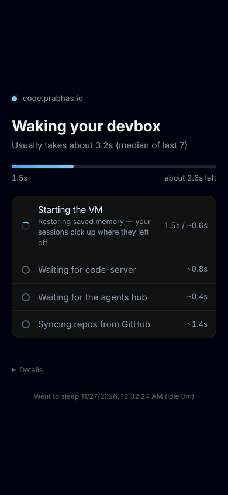
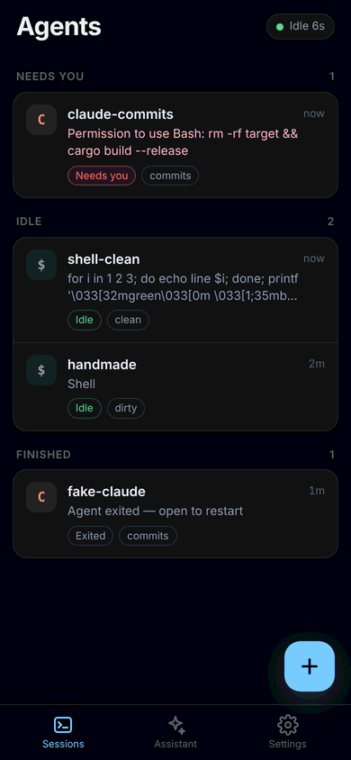
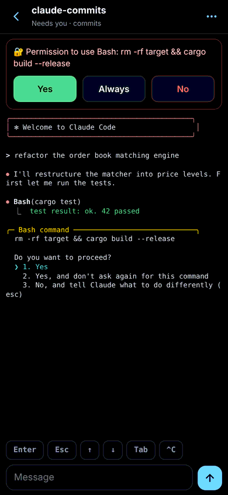

# devbox

**A personal development machine on your own server that sleeps when you're away, wakes when you arrive, and lets you run and steer coding agents from your phone.**

> **Status: in development.** The design is complete ([spec](docs/spec/README.md)); the implementation is being built milestone by milestone ([milestones](docs/milestones.md)). Nothing below is released yet.

| Boot screen | Agents app | Agent needs you |
|---|---|---|
|  |  |  |

## What you get

- **`code.<your-domain>`** — VS Code in the browser (code-server) on an Incus VM.
- **`agents.<your-domain>`** — an installable phone app for coding agents (Claude Code, Codex, opencode, any terminal agent). Sessions run in tmux on the VM, so they keep going when you close the app. You get a push notification when an agent needs permission, asks you something, errors, or finishes a long task — tap it, answer, done.
- **Sleeps when idle, wakes on demand.** After 15 quiet minutes the VM is suspended with its memory saved, giving the server its CPU and RAM back. Opening either URL (or SSH) wakes it in seconds, with a boot screen that shows progress and an ETA learned from previous wakes. Everything — terminals, dev servers, agents — resumes exactly where it was.
- **`ssh devbox` from anywhere** — through the same public path as the editor, with no VPN and nothing to install beyond one small client. Connecting to a sleeping devbox wakes it and shows the progress right in your terminal. Port forwards, agent forwarding, scp/sftp and VS Code Remote-SSH all work.
- **Every repo current on every wake** — all your GitHub repos cloned and synced. Local work is never lost: if an update would conflict, the repo is left exactly as it was and you're told.
- **AI context about how you work** — a continuously refreshed description of your stack, habits and active projects, kept in your private dotfiles repo and read by every agent.
- **One command to set up or rebuild** — and it keeps itself up to date: pushes to this repo redeploy the gateway and the agents hub, visible in GitHub's Deployments.

## How it fits together

```
phone / browser / ssh ─► Traefik ─► devbox-gateway (host, Docker) ─┬─► code-server   ┐
  (ssh: over WebSocket,               wake · boot screen · sleep      ├─► agents hub    │ Incus VM
   via devbox-ssh)                    SSH server · health             └─► sshd          ┘ (sleeps when idle)
```

- **devbox-gateway** (Go): the front door. Proxies to the VM when it's awake; wakes it and shows the boot screen when it's not; puts it to sleep when idle. It also answers SSH itself, so it can wake the VM and show progress before handing you to the VM's shell.
- **devbox-hub** (Go + a TypeScript PWA): runs in the VM; manages agent sessions, receives agent hooks, sends notifications, serves the agents app.
- **devbox** (Rust): the CLI — `devbox up` sets everything up on the host; `devbox sync` and `devbox context` run in the VM.
- **devbox-ssh** (Go, ~5 MB): the only thing your laptop needs — a `ProxyCommand` that carries SSH over HTTPS, installed by the one-line setup below.

## Quickstart (once released)

Requirements: a Linux server with systemd, [Incus](https://linuxcontainers.org/incus/) ≥ 6.0, Docker, and Traefik (e.g. via [Dokploy](https://dokploy.com)); a domain on Cloudflare (or any DNS pointing at Traefik).

1. **Deploy the gateway** in Dokploy as a Compose app from this repo (`deploy/gateway/compose.yml`, Auto Deploy on, no domain, no previews) — see [docs/deploy-gateway.md](docs/deploy-gateway.md).
2. **Install the CLI and run one command** on the server:

   ```bash
   curl -fsSL https://github.com/prabhask5/devbox/releases/latest/download/install.sh | sudo sh
   sudo devbox up --domain example.com --dotfiles git@github.com:you/dotfiles
   ```

   It creates (or adopts) the VM, provisions code-server, the agents and the hub, writes the routes for `code.example.com`, `agents.example.com` and `devbox.example.com`, opens exactly the firewall ports needed, and checks everything works end to end.
3. **On your phone**, open `agents.example.com` in Safari → Share → Add to Home Screen → open it → Settings → Enable notifications.
4. **On each computer** (macOS or Linux), run:

   ```bash
   curl -fsSL https://devbox.example.com/setup | sh
   ```

   It installs `devbox-ssh` into `~/.local/bin`, asks for your agents app password once to pair the computer's SSH key, and adds a `Host devbox` entry to your SSH config. Then `ssh devbox` works from anywhere. `curl -fsSL https://devbox.example.com/setup | sh -s -- remove` undoes it.

## Your dotfiles

devbox is generic; your personal setup lives in your own **private dotfiles repository**, which devbox reads through a small manifest (`devbox.toml`). Pass it to `devbox up --dotfiles <repo>` and rebuilding your exact machine is one command. devbox also writes your generated developer context into it. See **[docs/dotfiles.md](docs/dotfiles.md)** for the format and how to set one up or convert an existing one.

## Contributing

Read [CLAUDE.md](CLAUDE.md), the [spec](docs/spec/README.md) and [CONTRIBUTING.md](CONTRIBUTING.md). Security reports: [SECURITY.md](SECURITY.md). License: [MIT](LICENSE).
