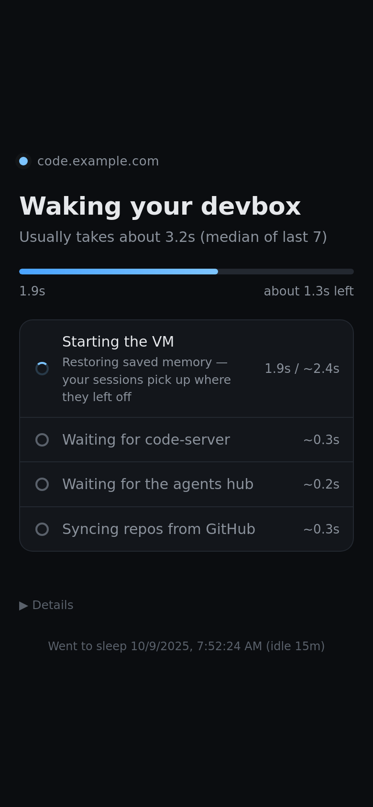
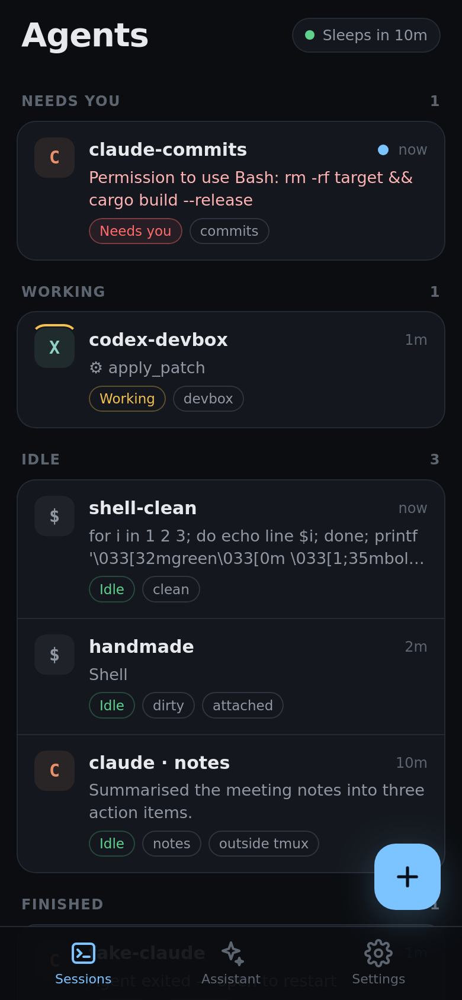
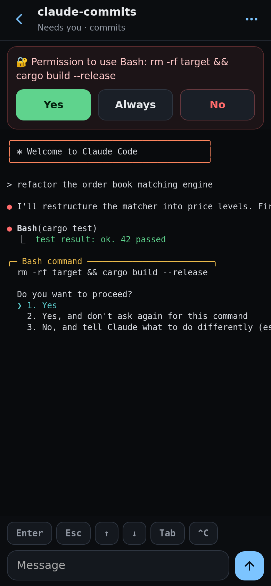
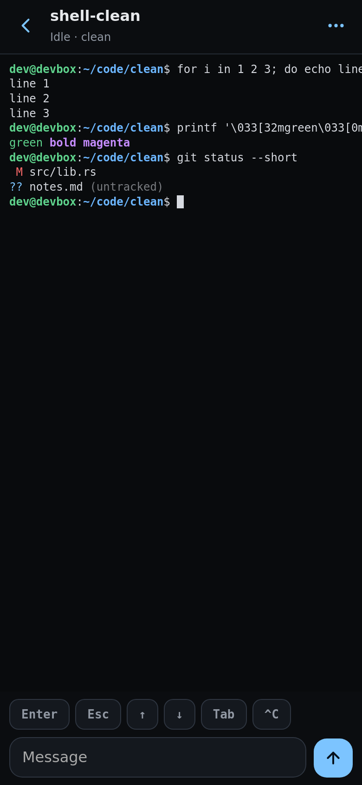

# devbox

Your own development machine on your own server: it sleeps when you are away, wakes when you arrive, and lets you run and steer coding agents from your phone.

devbox turns one Linux server with [Incus](https://linuxcontainers.org/incus/) into a personal, always-reachable dev VM. VS Code in the browser, `ssh devbox` from anywhere, an installable app for your coding agents, and nothing running while you are not there.

<p align="center">
  
  
  
  
</p>

## What you get

- **A VM that sleeps when idle and wakes when you arrive.** After 15 quiet minutes the VM is stopped with its memory saved, and the server has its CPU and RAM back. Opening the editor, the agents app or an SSH connection wakes it in seconds. Terminals, editors, dev servers and agent sessions are exactly where they were.
- **VS Code in the browser** at `code.<your-domain>` ([code-server](https://github.com/coder/code-server)).
- **An app for your coding agents** at `agents.<your-domain>`: watch, answer and start sessions of Claude Code, Codex, opencode or any terminal agent from your phone. Sessions run in tmux on the VM and keep going when you close the app. You get a push notification when an agent needs permission, asks you something, fails, or finishes a long turn; one tap answers.
- **`ssh devbox` from anywhere,** through the same public path as the editor: no VPN, no open port, one small client. Connecting to a sleeping devbox wakes it and shows the progress in your terminal. Port forwards, agent forwarding, `scp`, `sftp` and VS Code Remote-SSH work as with any server.
- **Every repository current on every wake.** All your GitHub repositories are cloned and kept up to date. Local work is never lost: when an update would conflict, the repository is left exactly as it was and you are told.
- **Context for your agents.** A description of how you work and what you are working on, refreshed from your repositories and written into your dotfiles, which every agent reads.
- **One command to set up, rebuild or undo.** `devbox up` creates the VM or adopts the one you have, and saves everything it replaces; `devbox down` puts it back.

## How it fits together

```
phone / browser / ssh ─► Traefik ─► devbox-gateway (host, Docker) ─┬─► code-server   ┐
  (ssh: over WebSocket,               wake · boot screen · sleep      ├─► agents hub    │ Incus VM
   via devbox-ssh)                    SSH server · health             └─► sshd          ┘ (sleeps when idle)
```

- **devbox-gateway** (Go) is the front door: it proxies to the VM while it is awake, wakes it and shows the boot screen when it is not, and puts it to sleep when nobody uses it. It answers SSH itself, so it can wake the VM for a connection and show the progress before handing over to the VM's shell.
- **devbox-hub** (Go, with a TypeScript app) runs in the VM: it keeps the agent sessions, hears from the agents through their hooks, sends the notifications and serves the agents app.
- **devbox** (Rust) is the command: `devbox up` sets up the host, `devbox sync` and `devbox context` run in the VM.
- **devbox-ssh** (Go, about 5 MB) is all a computer needs: a `ProxyCommand` that carries SSH over HTTPS.

## Requirements

- A Linux server with systemd, [Incus](https://linuxcontainers.org/incus/) 6.0 or newer and Docker. A VM needs hardware virtualization (KVM); a small machine does: the default VM has 3 CPUs, 5 GiB of memory and 60 GiB of disk.
- [Traefik](https://traefik.io) with HTTPS in front, for example the one [Dokploy](https://dokploy.com) runs. Without Traefik, `devbox up --routing none` tells you what to route.
- A domain with three names pointing at the server: `code.`, `agents.` and `devbox.` (the SSH host). They can sit behind Cloudflare.

## Quickstart

1. **Deploy the gateway**: one small container, with Dokploy or `docker compose` ([docs/deploy-gateway.md](docs/deploy-gateway.md)).

2. **Install the command and run it** on the server:

   ```bash
   curl -fsSL https://github.com/prabhask5/devbox/releases/latest/download/install.sh | sudo sh
   sudo devbox up --domain example.com
   ```

   It shows its plan and asks before it changes anything: the VM, code-server, the agents and the hub in it, the routes for the three names, exactly the firewall rule that is needed. It asks for two passwords, one for waking and one for the agents app, and ends by checking the whole path from outside. `sudo devbox doctor` repeats the checks at any time.

3. **On your phone,** open `https://agents.example.com` in Safari, Share → Add to Home Screen, open it from there, and enable notifications in Settings.

4. **On each computer** (macOS or Linux), once:

   ```bash
   curl -fsSL https://devbox.example.com/setup | sh
   ```

   It installs `devbox-ssh` into `~/.local/bin`, pairs the computer's SSH key (it asks for the app password) and adds a `Host devbox` entry to your SSH config. After that `ssh devbox` works from anywhere. `curl -fsSL https://devbox.example.com/setup | sh -s -- remove` undoes it.

## Guides

- [Deploying the gateway](docs/deploy-gateway.md): Dokploy or Docker Compose, checking it, going back.
- [Your dotfiles](docs/dotfiles.md): devbox is generic; your shell, git identity, editor settings, extra tools and agent instructions live in your own private repository, which `devbox up --dotfiles <repo>` applies. Rebuilding your exact machine is then one command.
- [Adopting a VM you already have](docs/adopting-an-existing-vm.md): putting devbox around an existing Incus VM without rebuilding it, and taking it off again.

## Questions

**What does it cost while it sleeps?** The gateway: about 12 MB of memory and no measurable CPU. The VM's memory is on disk, so keep its size plus 1 GiB free on the storage pool.

**What wakes it?** A page load of the editor or the agents app after the wake password, a paired SSH key, or a deploy of the hub if you allow that. Nothing wakes it without one of your credentials; health checks do not.

**What if restoring the memory fails?** The VM boots fresh instead and the boot screen says so. Your files are on its disk either way; only what was running is gone.

**Which agents?** Claude Code, Codex and opencode report through their own hooks, so the app knows when they work, wait for you or finish. Anything else that runs in a terminal can be started and watched as a shell session.

**Do I need Dokploy or Cloudflare?** No. The gateway is a plain container (`docker compose`, or the image `ghcr.io/prabhask5/devbox-gateway`), and any DNS that reaches your Traefik works.

**Is it safe to put this on the internet?** That is what it is built for: every public surface asks for a credential, only the gateway can reach the VM, SSH takes paired keys only, and secrets stay in two files that nothing prints. The rules and the tests that hold them are in [docs/spec/14-security.md](docs/spec/14-security.md). Report problems privately ([SECURITY.md](SECURITY.md)).

**More than one person, or more than one VM?** Not in this version: one owner, one VM per server. See the [roadmap](docs/roadmap.md).

**How do I get rid of it?** `sudo devbox down` restores every file it replaced and leaves the VM as a plain Incus VM; `--destroy` removes a VM that devbox created.

## Development

devbox is specified before it is built: [docs/spec/](docs/spec/README.md) says what every part does and which tests hold it. Architecture and conventions are in [CLAUDE.md](CLAUDE.md), how to contribute in [CONTRIBUTING.md](CONTRIBUTING.md).

```bash
scripts/ci.sh              # everything CI runs; `scripts/ci.sh go rust` for single stages
go test ./...              # Go
cargo test --workspace     # Rust
pnpm -C web test           # TypeScript; scripts/e2e.sh for the browser scenarios
```

It needs Go, Rust (rustup) and Node with pnpm, at the versions pinned in `go.mod`, `rust-toolchain.toml` and `.node-version`. Tests never touch the machine they run on: Incus, GitHub and the push service are faked, and the real thing runs nightly on a throwaway runner.

```
cmd/         the Go programs: devbox-gateway, devbox-hub, devbox-ssh
internal/    their packages
crates/      the Rust workspace: the devbox command and its libraries
web/         the boot screen and the agents app (Preact)
contracts/   JSON Schemas of every message and config file; Go, Rust and TypeScript types are generated
deploy/      the gateway's Dockerfile and compose file
tests/       every test, the fakes and the fixtures
docs/        the specs and the guides
```

## License

[MIT](LICENSE)
